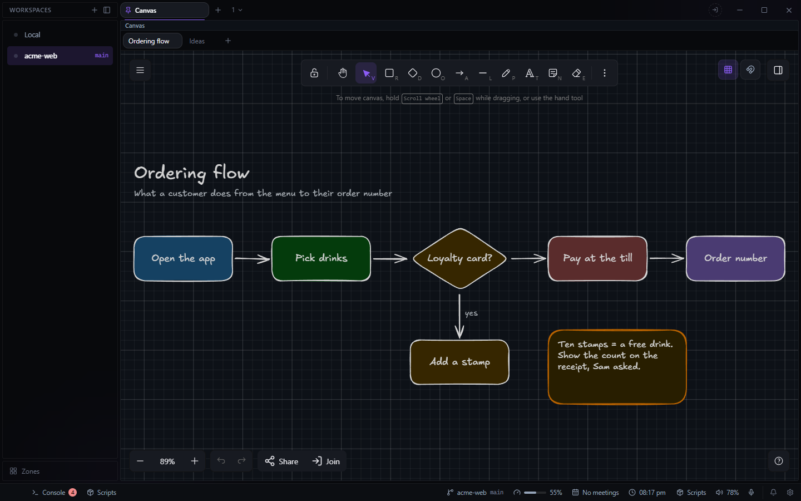

# Canvas for Deck

Excalidraw boards for each project, in a pane: sketch, diagram, paste screenshots and links, and
draw on a board live with other Decks. Open it from the **+** beside your tabs, or a pane's menu,
and choose **Canvas**.

## Boards

Each workspace folder has its own boards, shown as tabs:

- **+** after the last tab makes a board; double-click a tab to rename it; the X deletes it.
- Right-click a tab to rename, duplicate or delete it.
- Drag a tab to reorder.
- The buttons at the top right show a grid and snap to it (hold Ctrl to move freely), for every
  board.

Boards save as you draw, in Deck's config on this machine: a `canvas-<project>` file per board,
with its pasted pictures in a `-files` file beside it, and the grid choice in `canvas-grid`. They
do not sync.

## Drawing together

**Share** (bottom of a board) lets the people in your Deck team draw on it with you, live, from
their own Deck. Start or join a team in Deck's Settings > Teams first. There is no server of yours
involved: the Decks connect directly, and find each other through public Nostr relays that only
ever see an encrypted handshake.

- **Share** › everyone in a team, or one person in it. Sharing starts at once, with everyone able
  to edit.
- They get a notification, *name* invites you to *board*, with **Join**: one click opens the board,
  with no code to type and no waiting to be let in. Someone offline gets it when they come online
  while the board is still shared.
- The others see your name from Deck's Settings > General (empty uses your Google account's name,
  else your Windows account's).
- While shared you see each other's cursors, names, laser pointer and pictures (up to 4 MB each),
  and the bar shows each connection's round trip in ms.
- Click the bar's status to let everyone edit or not, set one person to edit or view only, or
  remove someone.
- Switching tab or workspace keeps the share running; the board is up to date when you come back.
- When the host stops, Canvas offers to keep what was drawn, go back to the board as it was
  before sharing (a backup is taken when sharing starts), or keep both. A guest can keep a copy.

Everyone needs the same Canvas build to share; a different one is told so. Networks where two
machines cannot connect directly (some offices and mobile networks) are not handled yet.

Canvas was Deck's built-in Pinboard until 1.1. Deck renames old boards to Canvas's files the
first time it starts, so a board you made there is the first tab here.
